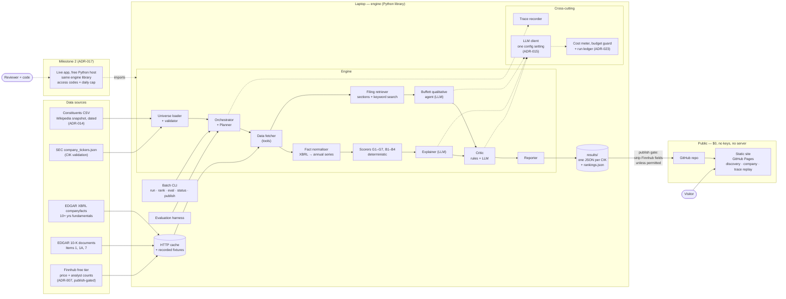

# Architecture — Graham & Buffett Equity Research Tool (v1)

> Research and analysis tool. **Not financial advice.**
> Version: v1 draft · 2026-10-08 · Consistent with ADR-001 to ADR-023 (ADR-018 to ADR-023 introduced with this view, see §7).

This document has four views:

1. **System view** — components, data sources and where each runs.
2. **Agent hand-off view** — one company analysis, step by step, with the contract passed at each hand-off.
3. **Component catalogue** — what each component is (deterministic code, tool or LLM), its cost and its failure behaviour.
4. **Run economics** — LLM calls and cost per analysis.

---

## 1. System view

Everything that spends quota or holds a key runs on the laptop. The public site only reads files (ADR-016).



**Reading the diagram**

- **Solid lines** are data flow. **Dotted lines** are calls to cross-cutting services or milestone-2 paths.
- **The cache is the only door to the outside world.** In development and evaluation it is replaced by recorded fixtures, so no live calls happen (project cost rule).
- **The results JSON is the contract** between the engine and the site. It is versioned (`schema_version`); the site never computes anything.
- **The publish gate is enforced in code**, not by memory: `publish` drops every Finnhub-sourced field unless `FINNHUB_PUBLIC_OK=true` is set in config (ADR-007, proposed ADR-021).

---

## 2. Agent hand-off view (one company)

Three LLM roles do real work: the **qualitative agent** (a tool-using loop over the 10-K), the **Explainer** and the **Critic**. Everything else is deterministic, by design (ADR-005).

```mermaid
sequenceDiagram
    autonumber
    participant CLI as Batch CLI
    participant ORC as Orchestrator + Planner
    participant DF as Data fetcher
    participant SC as Scorers (Python)
    participant QA as Qualitative agent (LLM)
    participant FR as Filing retriever
    participant EX as Explainer (LLM)
    participant CR as Critic
    participant RP as Reporter

    CLI->>ORC: analyse(ticker)
    ORC->>ORC: normalise ticker, check S&P 500, resolve CIK
    alt outside v1 scope
        ORC-->>CLI: "outside v1 scope" (no further calls)
    end
    ORC->>DF: fetch(CIK)
    DF-->>ORC: DataBundle (series, 10-K refs, price, analyst counts, gaps, as-of dates)
    ORC->>ORC: build RunPlan (applicable criteria by sector, data gaps, steps to skip)
    ORC->>SC: score(DataBundle, RunPlan)
    SC-->>ORC: ScoreSet (G1–G7, B1–B4: result, figure, threshold, source, as-of)
    ORC->>QA: assess(4 qualitative criteria, 10-K refs)
    loop up to N tool calls per criterion
        QA->>FR: search(section, query)
        FR-->>QA: passages with accession no. + section + offset
    end
    QA-->>ORC: QualFindings (verdict + cited sentences with exact offsets; "insufficient evidence" if the filing does not show it, "not assessed" if the system could not judge)
    ORC->>EX: explain(ScoreSet)
    EX-->>ORC: Explanations (one line per criterion)
    ORC->>CR: verify(ScoreSet, QualFindings, Explanations)
    CR->>CR: rule checks: figures match ScoreSet, quotes exist in cached 10-K, banned phrases
    CR->>CR: LLM check: does each quote support its verdict?
    alt any check fails
        CR-->>ORC: CriticReport (failed items, routed to owner)
        ORC->>EX: retry once (failed explanations only)
        ORC->>QA: retry once (failed findings only)
        ORC->>CR: verify again
    end
    CR-->>ORC: CriticReport (pass, or fail + warning)
    ORC->>RP: assemble(all of the above, trace, cost)
    RP-->>CLI: results/{CIK}.json
```

### Hand-off contracts

Each arrow carries a typed object (Pydantic models). These are what the trace replay shows, step by step.

| Contract | Produced by | Key fields |
|---|---|---|
| `RunPlan` | Planner | ticker, CIK, sector, applicable criteria, skipped criteria + reason, steps |
| `DataBundle` | Data fetcher | annual series per concept, 10-K accession numbers, price, analyst counts, `gaps[]`, `as_of` per source |
| `ScoreSet` | Scorers | per criterion: result label, figure, threshold, years covered, source URL, as-of |
| `QualFindings` | Qualitative agent | per criterion: verdict, rationale, 0–2 citations (accession, section, passage, sentence numbers, quote and offsets built by code), searches and tool calls made, stop reason |
| `Explanations` | Explainer | per criterion: one plain-English line, figures referenced |
| `CriticReport` | Critic | per check: pass/fail, failing item, owner to retry, attempt number |
| `Result` | Reporter | all of the above + scorecard + trace + `cost` + `schema_version` + disclaimer |

---

## 3. Component catalogue

| Component | Type | Responsibility | Failure behaviour |
|---|---|---|---|
| Universe loader | Python | Load dated constituents CSV, validate against SEC ticker file, dedupe share classes, normalise tickers (ADR-014) | Refuse to run on validation failure |
| Orchestrator + Planner | Python (rules) | Scope check; build `RunPlan` from sector rules (ADR-013) and data availability; drive steps; route critic failures | Skips steps it can't run and records why |
| Data fetcher | Tools | `edgar_facts`, `edgar_filing`, `finnhub_quote`, `finnhub_recs`, all through the cache. SEC fair-access rules: declared User-Agent, ≤ 10 req/s | Missing field → `gaps[]`; never guesses |
| HTTP cache / fixtures | Storage | Content-addressed cache of raw responses; fixtures are a frozen copy for the 5 test tickers (ADR-024) | Cache hit = no network |
| Fact normaliser | Python | Map XBRL concepts to one annual series per measure (e.g. several revenue tags → `revenue`), fiscal-year alignment | Unmapped concept → data gap with the tags tried |
| Scorers | Python, pure functions | G1–G7, B1–B4 exactly as `PROCESS.md` §5 | Labels: pass · fail · partial · n/a · not meaningful · data gap |
| Filing retriever | Python | Extract 10-K Items 1, 1A, 7; chunk; keyword/BM25 search (no embeddings, $0, ADR-022) | Section not found → returned as "not found", agent records it |
| Qualitative agent | LLM + tools (`engine/agents/qualitative.py`) | Four independent loops (one per Buffett qualitative criterion): seeded search in code, then `search` / `get_passage` / `submit_finding`, max 4 turns; passages shown as numbered sentences and cited by pointer, so quote and offsets are built by code and checked against the passages retrieved in the loop (ADR-041 to ADR-047) | No valid citation → "not assessed" with a stop reason (`turn_cap`, `invalid_citation`, `section_missing`, `llm_output_error`); quota and budget errors propagate (ADR-044) |
| Explainer | LLM (`engine/agents/explainer.py`) | One line per pass/fail/partial/not-meaningful criterion, one call per company; writes `{placeholders}`, code renders the figures from the ScoreSet with `config/figure_formats.json`; n/a and data-gap results get a templated line (ADR-048) | Critic rule R1 flags a bad placeholder, a stray numeral or a text that is not the rendering; one retry, then a warning |
| Critic | Rules first, then LLM (`engine/agents/critic.py`, `review.py`) | R1 explanations structurally valid and reproducible from the ScoreSet; R2 citations re-verified against the re-loaded 10-K (sha256, offsets, passage and section bounds); R3 banned language (`config/banned_phrases.json`); L1 one model call per company: does each found/weak quote support its verdict and does the rationale add nothing (ADR-019, ADR-049) | Failed items only go to their owner once and are re-checked; still failing: kept with a visible warning. The Critic never rewrites a verdict or a sentence. Does not review "insufficient evidence" / "not assessed" |
| Reporter | Template | Assemble `Result` JSON with scorecard, sources, dates, trace, cost, disclaimer | Schema validation before write |
| Rankings builder | Python | Build `rankings.json`: criteria ranking (% applicable met) and analyst ranking, side by side, no linking (ADR-004) | Companies with gaps shown with gap count |
| LLM client | Adapter | OpenAI-compatible endpoint + model name + key env var in one config (ADR-015) | Backoff on rate limit; fallback model per config |
| Cost meter + budget guard | Python | Count tokens, calls and $ per company, per day and in total; check projected cost before every call against the free-tier daily quota and the paid cap (ADR-023) | Stops the batch cleanly; resumes from the ledger |
| Run ledger + `status` | Python | One row per company (status, model, calls, tokens, actual and notional $); writes `PROGRESS.md` and the site coverage line | — |
| Trace recorder | Python | Record every step's input/output contract, timings and critic findings | — |
| Evaluation harness | Python | Same engine against fixtures: expected checks, failure cases, ±20% threshold sensitivity (ADR-011), model comparison (ADR-015) | Report what the tool gets wrong |
| Static site | HTML/JS | Discovery page, company page, trace replay, "data as of" banner, disclaimer | Shows whatever the JSON says, including warnings |

---

## 4. Run economics

Model: Gemini 3.1 Flash-Lite for all runs (ADR-015 as amended). The qualitative agent is measured on the 5 test tickers (2026-10-09); the Explainer and Critic are measured on the same five (2026-10-10).

| Step | LLM calls per company | Notes |
|---|---|---|
| Qualitative agent | 5–9 (mean 6.6, measured) | One loop per criterion, seeded first search; tool calls to the retriever are local and free. Measured on the 5 test tickers: mean 17.3k input + 0.87k output tokens, notional $0.0056 per company (`docs/qualitative_report.md`) |
| Explainer | 1 (measured) | All numeric criteria in one call; 0 retries needed on the 5 test companies |
| Critic (LLM part) | 1.6 (measured: 1 check, which also reviews the explanations, plus a re-check when something is sent back) | Rule checks cost nothing |
| Repairs (rationale rewrites 1 call, constrained retries up to 3 turns) | 1.2 (measured: 5 repairs over 5 companies) | Only failed items, once (ADR-052) |
| **Total** | **~10.4 (measured)** | About 25k input + 2.3k output tokens, notional $0.010 per company (`docs/critic_report.md`) |

| Mode | Cost per company | Full S&P 500 | Time |
|---|---|---|---|
| Free tier | $0.00 | $0.00 | ~1–2 weeks of daily quota (limit to confirm in AI Studio) |
| Paid, standard ($0.25 / $1.50 per M tokens) | ~$0.010 (measured) | ~$5 (under the $6 engine cap) | Hours |
| Paid, Batch API (half price) | ~$0.005 | ~$2.5 | Deferred: not v1 (ADR-023 §7) |
| **v1 plan: hybrid** | free first, paid up to $6 | ≤ $6 paid | Days, not weeks |

- **Budget:** engine cap $6.00, Google project spend cap $7 (ADR-023, amended 2026-10-10). Paid mode is locked until the evaluation harness passes.
- **Demo shows both:** "actual $0.00x (free tier + paid) · notional $0.0xx at paid rates", from the ledger, recorded at run time.

---|---|---|
| Qualitative agent | 5–9 (mean 6.6, measured) | One loop per criterion, seeded first search; tool calls to the retriever are local and free. Measured on the 5 test tickers: mean 17.3k input + 0.87k output tokens, notional $0.0056 per company (`docs/qualitative_report.md`) |
| Explainer | 1 (measured) | All numeric criteria in one call; 0 retries needed on the 5 test companies |
| Critic (LLM part) | 1.6 (measured: 1 check, which also reviews the explanations, plus a re-check when something is sent back) | Rule checks cost nothing |
| Repairs (rationale rewrites 1 call, constrained retries up to 3 turns) | 1.2 (measured: 5 repairs over 5 companies) | Only failed items, once (ADR-052) |
| **Total** | **~10.4 (measured)** | |

- **Actual cost:** $0.00 per analysis on the Gemini Flash-Lite free tier.
- **Throughput:** at ~500 requests/day (reported, not published), roughly 47 companies per day (about 10.4 requests each, measured: 6.6 qualitative, 1.0 Explainer, 1.6 Critic, 1.2 repairs), so the full S&P 500 in about 1–2 weeks. The numeric scorecard for all ~500 companies needs no LLM and runs in minutes.
- **Demo shows both:** "actual $0.00 (free tier) · notional $0.00x at paid rates", where the notional figure is token counts × the published paid price, recorded at run time.

---

## 5. Where the agentic behaviour is (interview framing)

| Behaviour | Where it lives | Why here |
|---|---|---|
| Planning | Planner builds a per-company `RunPlan` (sector exceptions, gaps, skipped steps) | Plans genuinely differ by company; rules make them reproducible |
| Tool use | Data fetcher; qualitative agent choosing what to search in the 10-K | The agent decides which sections and queries to use, and when it has enough evidence |
| Verification | Critic: rules for facts, LLM for judgement, retry routed to the step that failed | Cheap checks first; the LLM is used only where rules can't decide |
| Traceability | Typed contracts at every hand-off, replayed on the site | A reviewer can see each step's inputs and outputs |

---

## 6. Deliberately out of v1

Price charts and Alpaca (ADR-008) · non-S&P 500 tickers (ADR-002) · live mode (milestone 2, ADR-017) · embeddings / vector store (keyword search is enough for three 10-K sections, ADR-022) · any commentary linking the two rankings (ADR-004).

---

## 7. Decisions this diagram introduced

Accepted 2026-10-08, logged in `DECISIONS.md`:

- **ADR-018** Planner is rule-based; the agentic loop lives in the qualitative agent.
- **ADR-019** Critic runs rule checks first, LLM only for "does the quote support the verdict" (amended by ADR-048 to ADR-051: placeholders, routing, gold set, same model).
- **ADR-020** Typed hand-off contracts and a versioned results schema.
- **ADR-021** Finnhub publish gate enforced in the publish step.
- **ADR-022** Keyword search over the three 10-K sections; no embeddings or vector store in v1.
- **ADR-023** Progress ledger and hard-capped paid budget (Gemini 3.1 Flash-Lite, $4 engine cap under a $5 Google cap, free tier first).
