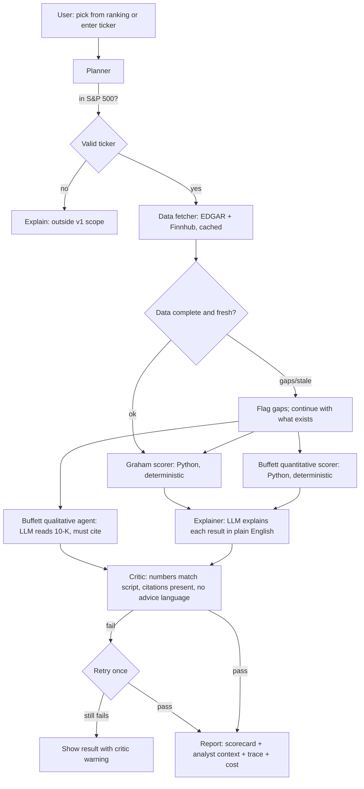
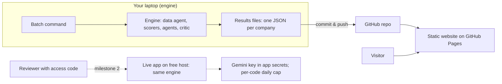

# Process Map — Graham & Buffett Equity Research Tool

> Research and analysis tool. **Not financial advice.** The tool reports which criteria a company meets and why; it never recommends buying or selling.

## 1. The workflow being automated

**As-is (manual analyst workflow)**
1. Pick a company (from a screen, news, or analyst coverage).
2. Pull 10+ years of financial statements from filings.
3. Compute ratios by hand or in a spreadsheet (P/E, current ratio, ROE, margins...).
4. Check each against a value-investing checklist.
5. Read the annual report (10-K) to judge the business qualitatively.
6. Write up conclusions, often without consistent sourcing.
7. Separately, look up what sell-side analysts think.

**Pain points:** slow (hours per company), error-prone arithmetic, inconsistent criteria between companies, qualitative judgements rarely cited, analyst view and fundamentals never shown side by side.

**To-be (this tool):** the arithmetic is deterministic and repeatable; the judgement is done by agents that must cite the filing; every figure carries a source and date; a critic checks the output before the user sees it.

## 2. Inputs

| Input | Source | Notes |
|---|---|---|
| S&P 500 constituent list | Wikipedia snapshot (CSV, dated) | Includes CIK + GICS sector; validated against SEC ticker file; refreshed quarterly |
| Financial statements (10+ yrs) | SEC EDGAR (XBRL company facts) | Public domain; ~2009 onwards |
| 10-K text sections | SEC EDGAR filings | For qualitative Buffett criteria |
| Current share price | Finnhub (free tier) | Pending permission to display publicly |
| Analyst recommendation counts | Finnhub (free tier) | Pending permission to display publicly |

## 3. Two entry points

- **Discovery mode:** two rankings shown side by side, with no commentary linking them:
  - *Criteria ranking*: S&P 500 ranked by Graham + Buffett criteria met.
  - *Analyst ranking*: S&P 500 ranked by analyst consensus.
  The user picks a company to open its full analysis.
- **Ticker mode:** the user enters any S&P 500 ticker and gets the same analysis.

## 4. Process steps and hand-offs

| Step | Owner | Type | Decision point |
|---|---|---|---|
| Plan run | Planner | Rules (ADR-018) | Is ticker in scope? Which steps are needed? |
| Fetch data | Data fetcher | Tools (APIs + cache) | Is data complete and current? Flag rather than guess |
| Graham criteria | Python script | Deterministic | Pass / fail / data gap per criterion |
| Buffett quantitative | Python script | Deterministic | Pass / fail / data gap per criterion |
| Buffett qualitative | Buffett agent | LLM + filing retrieval | Judgement must cite 10-K sentences by pointer; otherwise "insufficient evidence" (not shown) or "not assessed" (could not judge) |
| Explain | Explainer | LLM | Describes what the figure means with placeholders that code fills in (ADR-048); no investment opinion |
| Verify | Critic | Rule checks first (explanations reproducible from the ScoreSet, citations re-verified against the stored 10-K, banned language), then one model check on found/weak findings (ADR-019, ADR-049) | Failed items go back to their owner once, then show a warning; the Critic never rewrites |
| Report | Reporter | Template | Assemble scorecard, sources, dates, trace, run cost |

## 5. Criteria (accepted — see ADR-011 to ADR-013)

**Graham — defensive investor (7).** Source: *The Intelligent Investor* (1973), ch. 14. Graham's rules kept as written; only the dollar figure is updated.

| # | Criterion | Rule | Notes |
|---|---|---|---|
| G1 | Size | Revenue ≥ $1B | Graham's $100M (1972) ≈ $800M today, rounded up. Nearly all S&P 500 pass; kept for completeness. |
| G2 | Financial strength | Current ratio ≥ 2 **and** long-term debt ≤ net current assets | Utilities: Graham's variant, debt ≤ 2× equity. Banks/insurers: not applicable. |
| G3 | Earnings stability | Positive net income in each of the last 10 years | |
| G4 | Dividend record | Dividend paid in every year of a 15-year window | Graham asked for 20; EDGAR cannot cover that. Always labelled "partial (15 of 20 yrs)". Shorter record (e.g. recent listing/spin-off): pass if paid every year on record, labelled "N yrs on record". "On record" = years with annual financial data, not years with dividend data; a year counts only if dividends per share > 0 (ADR-012 amendment). A year with no dividend data between the first and last paid years is unknown: any confirmed unpaid year fails, otherwise an unknown year makes G4 a data gap naming the years (ADR-012 amendment 2026-10-11). |
| G5 | Earnings growth | 3-yr avg diluted EPS (end) ≥ 1.33× 3-yr avg diluted EPS (start of 10-yr window) | Per-share, so share issuance doesn't count as growth. |
| G6 | Moderate P/E | Price ≤ 15× avg EPS of last 3 years | Needs price (Finnhub). |
| G7 | Price vs assets | P/E × P/B ≤ 22.5 | Needs price (Finnhub). |

**Sector classes (ADR-057, ADR-058).** The class that drives the exceptions comes from the company's GICS sub-industry (per-CIK overrides for custody banks), with SIC as the fallback for tickers outside the S&P 500 snapshot: bank and insurer (G2 and B2 to B4 not applicable), utility (G2 variant), reit and other. **REITs are flagged, not exempted:** all rules apply unchanged and each REIT result carries the note "REIT: structurally debt-funded and required to distribute most taxable income; B1/B2 results reflect that structure."

**Buffett — quantitative (4, Python).** Buffett published principles, not numbers; these are documented interpretations.

| # | Criterion | Rule | Notes |
|---|---|---|---|
| B1 | Return on equity | ROE ≥ 15% in ≥ 7 of last 10 years | Negative/near-zero equity → "not meaningful". |
| B2 | Conservative debt | Long-term debt ≤ 4× avg net income of last 3 years | Banks/insurers: not applicable. |
| B3 | Stable margins | Operating margin > 0 every year **and** last-3-yr avg ≥ 90% of 10-yr avg | Tests consistency, not level, so sectors compare fairly. Banks/insurers: not applicable. |
| B4 | Owner earnings | Net income + D&A − capex > 0 in ≥ 8 of 10 years **and** last-3-yr avg > first-3-yr avg | Total capex used as conservative proxy for maintenance capex. Banks/insurers: not applicable. |

**Buffett — qualitative (4, LLM with citations).** Understandable business · Durable competitive advantage · Candid management · Rational capital allocation. Each: "evidence found" / "evidence weak" / "insufficient evidence" (the filing, as retrieved, does not show it, or argues against it), each with 1–2 cited 10-K sentences (except "insufficient evidence"), or "not assessed" when the system could not judge (section not found, turn cap, invalid citation pointers, malformed model output). "Not assessed" says nothing about the filing. Rubric: `config/search_terms.json` (ADR-043, ADR-047).

**Result labels:** pass · fail · partial-data pass · not applicable · not meaningful · data gap. Ranking uses % of applicable criteria met; data gaps shown separately.

## 6. Outputs

- **Scorecard:** "Graham X/7 · Buffett Y/8 (a quantitative, b qualitative) · Z data gaps"
- Per criterion: result, actual figure, threshold, source, "as of" date, one-line explanation
- **Analyst context:** recommendation counts with source and date, shown next to the scorecard and never compared against it
- **Agent trace:** each step, inputs, outputs, critic findings
- **Run cost** (e.g. "$0.00x per analysis")
- **Disclaimer:** research tool, not financial advice

## 7. Failure handling (degrade, don't guess)

| Failure | Behaviour |
|---|---|
| Missing EDGAR field | Criterion marked "data gap", reason shown |
| History shorter than required | Pass/fail on available years, labelled with years covered (e.g. G4 "partial") |
| Finnhub unavailable or not permitted | Price-based criteria (Graham 6–7) shown as data gaps; analyst panel hidden or BYOK |
| LLM gives no valid citation, runs out of turns, or the section is missing | Qualitative criterion marked "not assessed" with the reason (ADR-047) |
| Critic fails twice | Result shown with visible critic warning |

## 8. Deployment shape (ADR-016, ADR-017)

- **Engine** runs on the laptop in batches; writes one results file per company.
- **Website** only displays those files: no AI calls, no keys, no server.
- **Live mode** (milestone 2): access-code-protected app running the same engine.

Full component and hand-off view: `ARCHITECTURE.md`.
